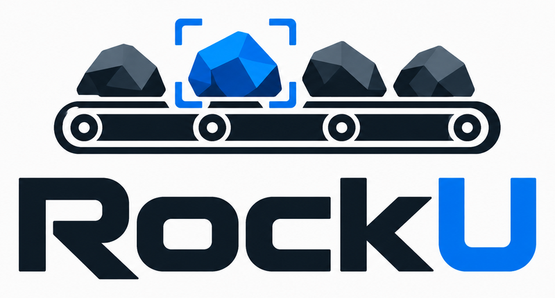
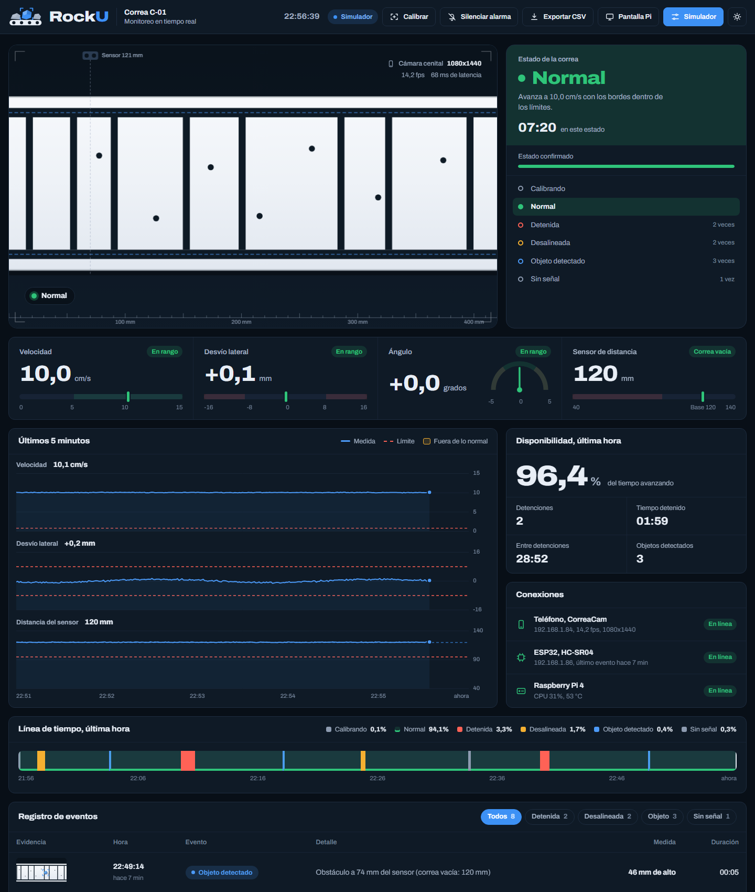

<p align="center">
  
</p>

# RockU, monitoreo de correas transportadoras

> **Este repositorio es un ejemplo para el Avance 3 de TEI201.** Muestra cómo ordenar un proyecto final y qué evidencia entregar. El código, los algoritmos, el panel y las métricas de simulación son reales y vienen del proyecto [RockU](https://github.com/ferjomendez/RockU). Las fotos, los renders, el plano, el BOM con precios y los resultados de pruebas con usuarios y con la correa física **fueron inventados para completar el ejemplo**. Cada archivo inventado lo dice en su cabecera o en la propia imagen. Antes de copiar nada, cambia esas partes por tu evidencia real.

## Información del equipo

- **Integrantes**
  - Fernando Méndez, líder del proyecto, coordinación y repositorio
  - Sam Altman, software y algoritmos de visión
  - Dario Amodei, hardware y electrónica
  - Elon Musk, diseño 3D y encapsulado
  - Mark Zuckerberg, testing, datos y documentación
- **ODS seleccionado** ODS 9, Industria, innovación e infraestructura
- **Problema a resolver** Las correas transportadoras de la minería se detienen sin aviso, se salen de su eje o arrastran objetos que dañan el sistema. Cada detención no planificada corta la producción y la detección suele depender de que alguien lo note.

## Descripción del proyecto

RockU es un prototipo a escala de un sistema de monitoreo para correas transportadoras. Un teléfono Android hace de cámara cenital sobre la correa y una Raspberry Pi 4 analiza las imágenes. La Pi mide velocidad, desvío lateral y ángulo, y con eso decide en qué estado está la correa. Un sensor ultrasónico HC-SR04 conectado a un ESP32 está pensado para avisar cuando pasa un objeto. Esa parte está diseñada y su contrato con la Pi está en la API, pero el firmware del sensor todavía no está escrito. Todo queda registrado en una base SQLite, se muestra en un panel web y en una pantalla de 3.5 pulgadas, y se puede exportar a CSV.

Detecta tres situaciones y las confirma por persistencia para evitar falsas alarmas.

- Correa detenida
- Desalineación lateral
- Paso de un objeto o piedra, con el sensor de distancia (firmware pendiente)



*Panel web capturado con el simulador del propio repositorio (`software/src/pi/dashboard/index.html`). Es una captura real del software, con datos simulados.*

## Estado del proyecto

- **Versión actual** v3.0
- **Última actualización** 06-11-2026
- **Estado** Prototipo final de ejemplo. En el proyecto real siguen pendientes el firmware del ESP32 con el HC-SR04, el punto de acceso WiFi de la Pi y la validación con la correa física

## Resultados clave

| Medida | Resultado | Origen |
|---|---|---|
| Exactitud de estados con imágenes sintéticas, condiciones moderadas | 100 % (1 936 cuadros) | Real, simulación |
| Exactitud en condiciones extremas | 86.9 % (1 520 cuadros) | Real, simulación |
| Error de velocidad en el caso base | 0.62 % de error medio absoluto | Real, simulación |
| Error de desvío lateral | 0.12 mm de error medio absoluto | Real, simulación |
| Tiempo de confirmación de una detención | 0.6 s en el caso base y 0.65 s en el difícil | Real, simulación |
| Imágenes por segundo, teléfono contra ESP32-CAM | 10.3 contra 5.6 | Real, medido desde la Pi |
| Pruebas con la correa física y con 5 usuarios | Ver `testing/` | **Inventado** |

## Estructura del repositorio

```
├── FUENTES.md         Fuentes, librerías y modelos de terceros (requisito habilitante)
├── hardware/          Esquemas, BOM, fotos y selección de componentes
├── software/          Código de la Pi, app Android, firmware y documentación técnica
│   ├── src/           pi/, android/ y firmware/
│   ├── docs/          API, plan del sistema, captura de datos y capturas del panel
│   └── librerias/     Dependencias y versiones
├── diseno_3d/         Fusion 360, planos y renders
├── testing/           Protocolo, reportes, datos y evidencias
├── documentacion/     Reporte final y presentación
└── iteraciones/       Historial de versiones
```

## Dónde está cada criterio de la rúbrica

| Dimensión | Criterio | Dónde mirarlo |
|---|---|---|
| Software 30 % | Captura de datos | [software/docs/captura_y_datos.md](software/docs/captura_y_datos.md) |
| | Repositorio de datos | [software/src/pi/registro.py](software/src/pi/registro.py) y [captura_y_datos.md](software/docs/captura_y_datos.md) |
| | Dashboard y visualización | [software/src/pi/dashboard](software/src/pi/dashboard) y [capturas](software/docs/img) |
| | Generación de información | [software/docs/captura_y_datos.md](software/docs/captura_y_datos.md) |
| | Calidad del código | [software/README.md](software/README.md) |
| Hardware 30 % | Selección de componentes | [hardware/README.md](hardware/README.md) |
| | Esquemático y BOM | [hardware/esquemas](hardware/esquemas) y [hardware/bom](hardware/bom) |
| | Montaje físico | [hardware/fotos](hardware/fotos) |
| | Diseño para la reparación | [hardware/README.md](hardware/README.md) |
| Diseño 3D 20 % | Gemelo 3D | [diseno_3d/fusion360](diseno_3d/fusion360) |
| | Modelado Fusion 360 | [diseno_3d/fusion360](diseno_3d/fusion360) |
| | Funcionalidad del encapsulado | [diseno_3d/README.md](diseno_3d/README.md) |
| | Planos técnicos | [diseno_3d/planos](diseno_3d/planos) |
| | Renders | [diseno_3d/renders](diseno_3d/renders) |
| Testing 10 % | Protocolo de pruebas | [testing/reportes/protocolo_pruebas.md](testing/reportes/protocolo_pruebas.md) |
| | Análisis de resultados | [testing/reportes/reporte_testing.md](testing/reportes/reporte_testing.md) |
| | Validación contra el problema | [testing/reportes/reporte_testing.md](testing/reportes/reporte_testing.md) |
| GitHub 5 % | Estructura y respaldo | Este repositorio y su historial de commits |
| Presentación 5 % | Claridad, demo y preguntas | [documentacion/presentacion](documentacion/presentacion) |

## Inicio rápido

### Requisitos previos

- Python 3.10 o superior para el servidor y el simulador
- Android Studio para compilar la app del teléfono
- Arduino IDE 2.x para el firmware del ESP32
- Fusion 360 para abrir el `.f3d`
- Raspberry Pi 4 con Raspberry Pi OS de 64 bits, solo para la versión con hardware

### Probar el software sin hardware

```bash
git clone https://github.com/ferjomendez/Repo-Ejemplo-TEI201.git
cd Repo-Ejemplo-TEI201/software/src/pi
pip install -r requirements.txt
python3 servidor.py --fuente sim
```

Abre `http://localhost:5000/` para ver el panel completo y `http://localhost:5000/mini` para la pantalla de 3.5 pulgadas. Si prefieres no instalar nada, abre `software/src/pi/dashboard/index.html` directamente en el navegador.

### Probar con la correa real

1. Arma la perfboard siguiendo [hardware/esquemas/detalle_perfboard.md](hardware/esquemas/detalle_perfboard.md).
2. Compila la app de `software/src/android` y arranca el servicio en el teléfono.
3. Calibra con la correa en condición normal y lanza el servidor con `--fuente real`. Los pasos completos están en [software/README.md](software/README.md).

## Checklist de entrega

Las casillas marcadas indican que el archivo existe en este ejemplo. Las que dicen "inventado" necesitan evidencia real en tu proyecto.

### Hardware

- [x] Esquema del circuito, [esquema general](hardware/esquemas/esquema_sistema.png) y [detalle de la perfboard](hardware/esquemas/detalle_perfboard.md)
- [x] BOM completo, [BOM.csv](hardware/bom/BOM.csv) (precios inventados)
- [x] Fotos de alta resolución, [hardware/fotos](hardware/fotos) (inventadas)

### Software

- [x] Código comentado
- [x] Librerías documentadas, [software/librerias](software/librerias)
- [x] Manual de instalación, [software/README.md](software/README.md)

### Diseño 3D

- [x] Archivo Fusion 360 de la perfboard con sus componentes, [diseno_3d/fusion360](diseno_3d/fusion360)
- [x] Ensamble completo de ejemplo en STL (inventado)
- [x] Renders, [diseno_3d/renders](diseno_3d/renders) (inventados)
- [x] Planos técnicos, [diseno_3d/planos](diseno_3d/planos) (inventados)

### Testing

- [x] Reporte de testing, [testing/reportes](testing/reportes) (la parte con usuarios es inventada)
- [x] Evidencias, [testing/evidencias](testing/evidencias)
- [x] Datos cuantitativos, [testing/datos](testing/datos)

### Documentación

- [x] Reporte final, [documentacion/reporte_final](documentacion/reporte_final)
- [x] Presentación de 10 minutos, [documentacion/presentacion](documentacion/presentacion)

## Licencia

Este proyecto se desarrolló como parte del curso TEI201 de la Facultad de Ingeniería y Ciencias de la Universidad Adolfo Ibáñez. El código se distribuye bajo licencia MIT, ver [LICENSE](LICENSE).
