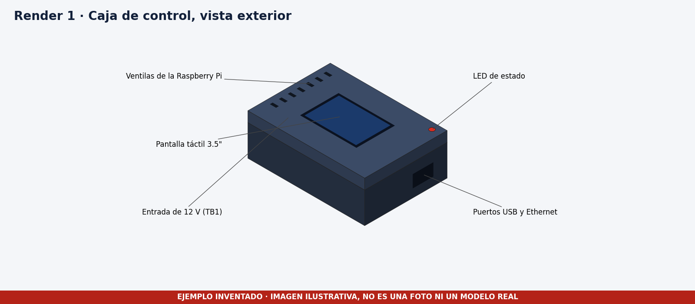
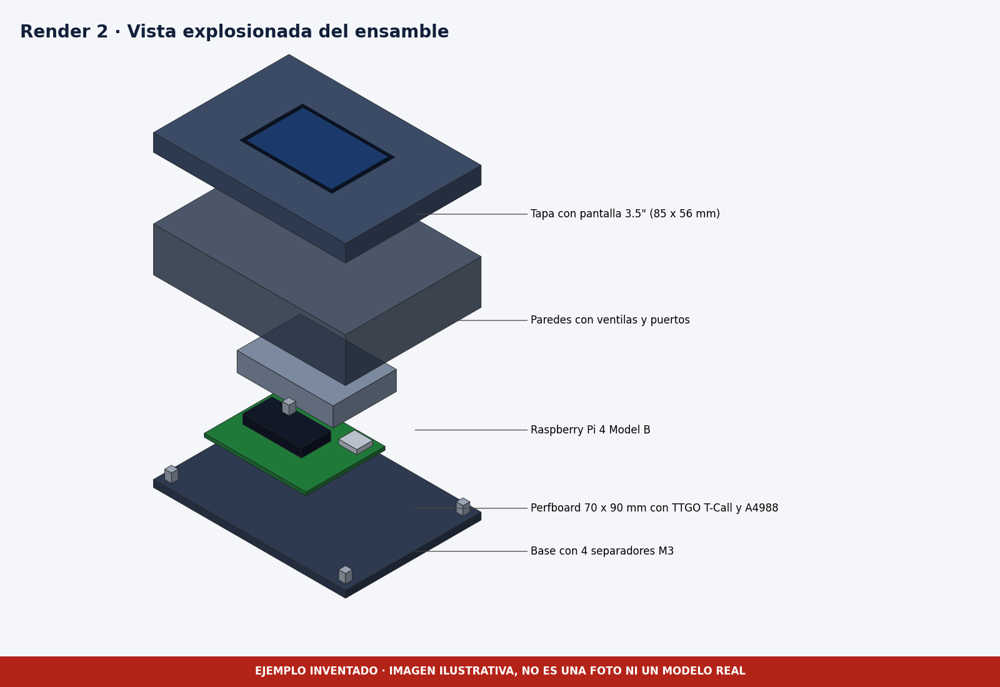

# Diseño 3D

> **Qué es real y qué es inventado.** El archivo `.f3d` de la perfboard con sus componentes es real y viene del proyecto RockU. El ensamble completo de la caja, los renders y el plano técnico **son inventados** para completar el ejemplo, y cada imagen lo advierte en su franja roja. En tu entrega, el gemelo 3D debe incluir todos los componentes y el `.f3d` debe abrir en Fusion 360.

## Requisito del gemelo 3D

El modelo debe tener todos los componentes del prototipo con sus volúmenes reales, no solo la caja vacía. La tabla indica cómo queda cada uno en este ejemplo.

| Componente | Estado en el ejemplo |
|---|---|
| Caja de control, base y tapa | Modelada en el ensamble de ejemplo, 170 x 120 x 60 mm |
| Raspberry Pi 4 Model B | Volumen de 85 x 56 x 17 mm |
| Perfboard con TTGO, driver, bornera y condensador | Modelo real en el `.f3d` y volúmenes en el ensamble |
| Pantalla de 3.5 pulgadas | Volumen de 85 x 56 x 5 mm bajo la ventana de la tapa |
| Separadores M3 | Cuatro bajo la perfboard y cuatro bajo la Pi |
| Motor, ESP32-CAM, HC-SR04, teléfono y fuente de 12 V | Fuera del encapsulado, modelados como volúmenes simples a un costado de la caja en el STL de ejemplo |
| Brazos de soporte | Descritos en las fotos, sin modelar |

## Carpetas

| Carpeta | Contenido |
|---|---|
| [fusion360](fusion360) | Archivos del modelo |
| [renders](renders) | Imágenes del ensamble |
| [planos](planos) | Plano técnico con vistas y cotas |

## Especificaciones de la caja

| Dato | Valor |
|---|---|
| Software | Autodesk Fusion 360 |
| Unidades | Milímetros |
| Escala | 1 a 1 |
| Dimensiones externas | 170 x 120 x 60 mm |
| Material | PLA, pared de 2.4 mm |
| Tolerancia | 0.2 mm general y 0.3 mm en el ajuste de la tapa |

## Funcionalidad del encapsulado

- La tapa tiene una ventana de 75 x 50 mm para la zona activa de la pantalla táctil, que va sujeta por detrás de la tapa.
- Hay siete ranuras de ventilación sobre la Raspberry Pi.
- El costado derecho deja abiertos el USB y el Ethernet de la Pi.
- La entrada de 12 V sale por el costado izquierdo, donde está la bornera.
- Un orificio de 7 mm en la tapa deja ver el LED de estado.
- La tapa se abre con cuatro tornillos M3, sin pegamento.
- Los separadores mantienen la electrónica a 12 y 14 mm del fondo, lejos de cualquier punto de apoyo.

