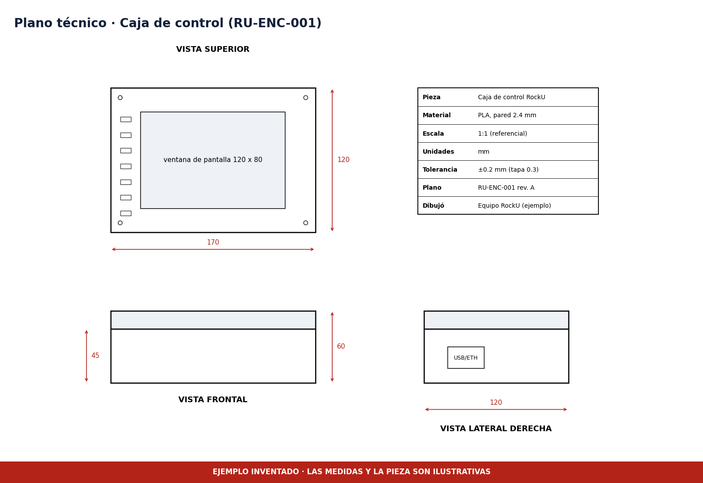

# Planos técnicos

> **El plano es inventado.** Muestra cómo presentar un plano de la caja de control, con vistas ortogonales, cotas, tolerancias y cajetín. Las medidas corresponden al ensamble de ejemplo y no a una pieza fabricada.

| Archivo | Contenido |
|---|---|
| [plano_01_encapsulado.png](plano_01_encapsulado.png) | Vista superior, frontal y lateral derecha de la caja, con cajetín |

## Qué debe tener un plano para la rúbrica

- Vistas ortogonales suficientes para reproducir la pieza.
- Cotas funcionales, como el largo, el ancho, el alto y la ventana de la pantalla.
- Tolerancias indicadas en el cajetín.
- Escala correcta y formato legible.

En Fusion 360 se genera desde el espacio de trabajo Drawing a partir del modelo. Exporta el resultado a PDF y súbelo junto al PNG.
