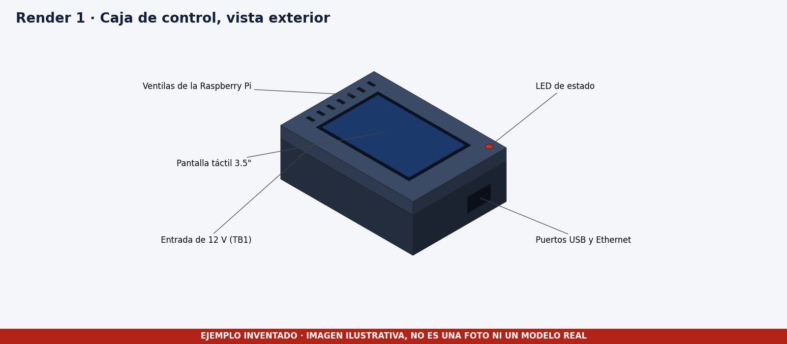
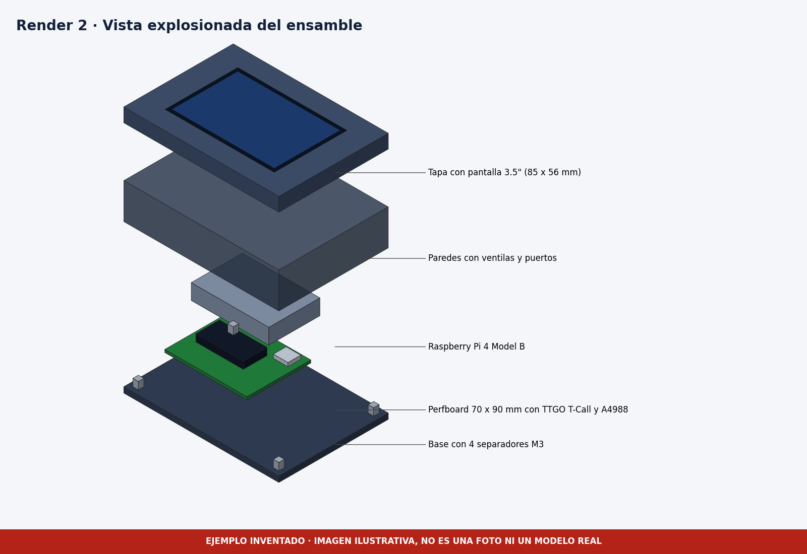
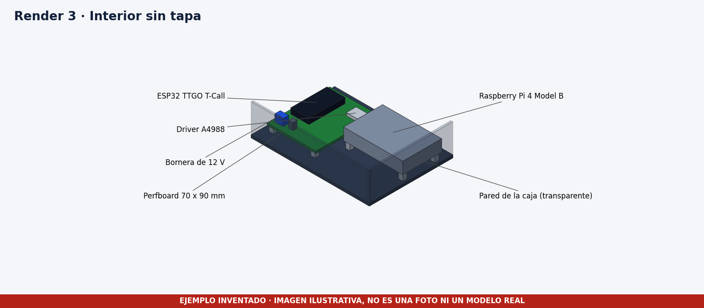

# Renders

> **Los renders son inventados.** Son ilustraciones dibujadas con código y llevan una franja roja que lo dice. En una entrega real deben salir de Fusion 360 con materiales aplicados, iluminación adecuada y varias vistas.

| Archivo | Qué muestra |
|---|---|
| [render_01_exterior.png](render_01_exterior.png) | Caja cerrada con pantalla, ventilas, LED y puertos |
| [render_02_explosionado.png](render_02_explosionado.png) | Capas separadas con los componentes |
| [render_03_interior.png](render_03_interior.png) | Interior sin tapa con la Pi, la perfboard y sus módulos |

Las vistas reales de la perfboard, con colores y cables, están en [hardware/esquemas](../../hardware/esquemas).
