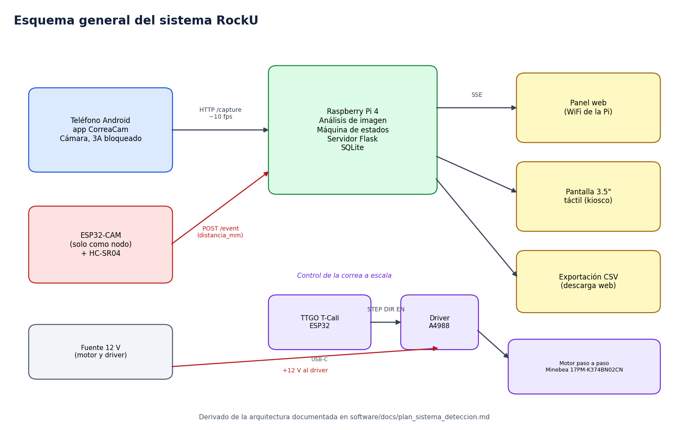
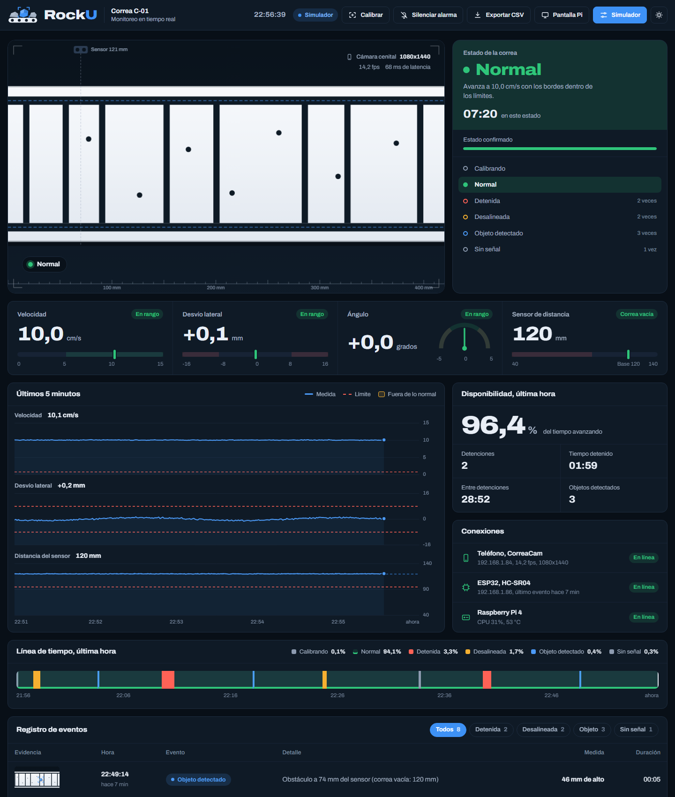
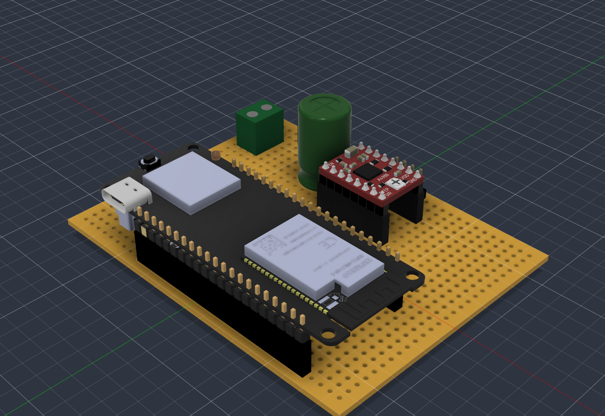
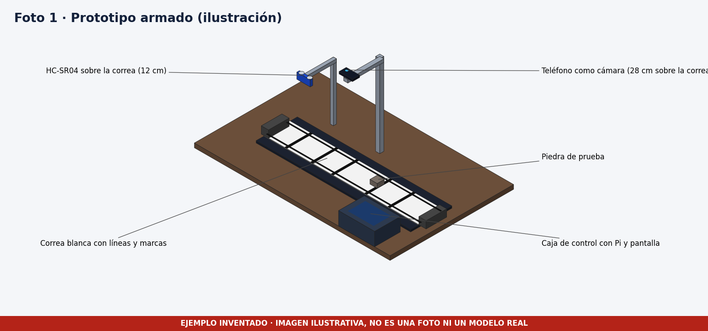
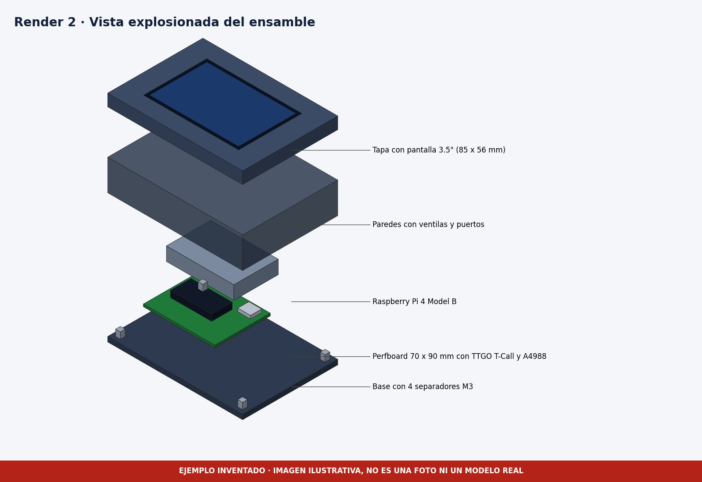
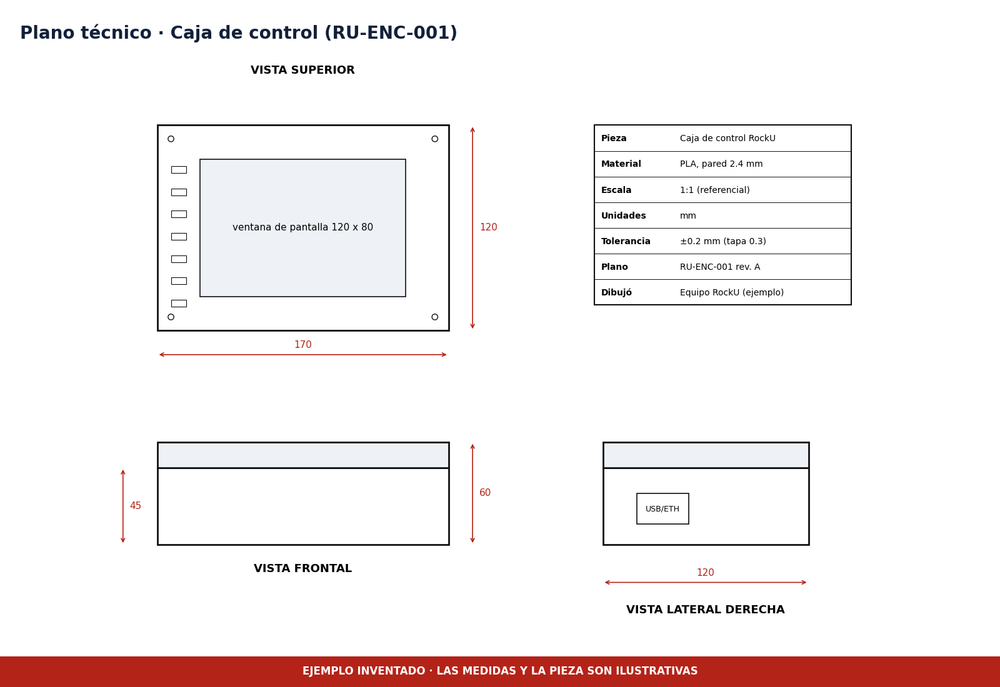
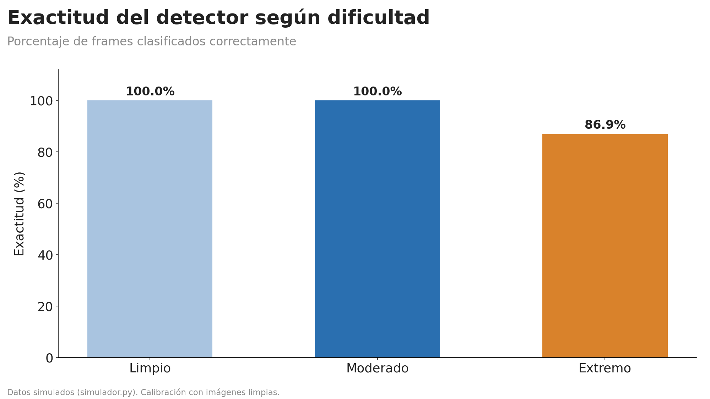

# RockU, monitoreo de correas transportadoras

Reporte final del Avance 3 · TEI201 · Universidad Adolfo Ibáñez

Equipo RockU (ejemplo) · 06-11-2026

> **Nota sobre este ejemplo.** El software, los algoritmos, las capturas del panel y las métricas de simulación son reales y vienen del proyecto RockU. Las fotos, los renders, el plano, los precios del BOM y los resultados con la correa física y con usuarios son inventados y están marcados donde aparecen. Este reporte muestra la estructura que se espera, no resultados medidos de todas sus secciones.

## 1. Problema y contexto

En la minería, las correas transportadoras mueven el mineral entre las etapas del proceso. Cuando una correa se detiene sin aviso, se sale de su eje o arrastra un objeto extraño, la producción se interrumpe y los daños crecen mientras nadie lo nota. El proyecto se enmarca en el ODS 9, Industria, innovación e infraestructura, y busca que el aviso llegue en segundos y con evidencia.

La pregunta de diseño es cómo detectar a bajo costo tres situaciones, la correa detenida, la desalineación lateral y el paso de un objeto, y presentarlas de forma que un operador decida rápido.

## 2. Solución propuesta

RockU es un prototipo a escala. Un teléfono Android ubicado a 28 cm sobre la correa entrega imágenes a una Raspberry Pi 4. La Pi mide velocidad por correlación de fase, y desvío y ángulo a partir de dos líneas impresas en la correa. Una máquina de estados confirma cada situación tras varios cuadros seguidos para evitar falsas alarmas. Un sensor HC-SR04 conectado a un ESP32 avisa cuando un objeto cruza bajo él, y la Pi pide una foto en ese instante.

Los datos se guardan en SQLite, se muestran en un panel web y en una pantalla de 3.5 pulgadas, y se exportan a CSV.

## 3. Software

### 3.1 Captura de datos

La cámara entrega unos 10 cuadros por segundo. A 5 a 15 cm/s la correa avanza entre 0.5 y 1.5 cm por cuadro, lo que basta para la correlación de fase y permite confirmar un cambio en menos de un segundo. El sensor de distancia lee unas 20 veces por segundo para no perder objetos pequeños. La app bloquea exposición, balance de blancos y enfoque para que la imagen no cambie por el autoajuste.

### 3.2 Repositorio de datos

SQLite guarda una muestra por segundo con velocidad, desvío, ángulo, distancia y estado, y una fila por cada evento con su foto. Hay un índice por tiempo, se conservan 30 días de muestras y el histórico se descarga en CSV con filtro de fechas.

### 3.3 Dashboard

El panel reúne en una pantalla el estado confirmado, las cuatro medidas con su rango normal, los gráficos de los últimos 5 minutos, la línea de tiempo de la última hora y el registro de eventos. Esta captura sale del modo simulador del propio software.

### 3.4 Información generada

El sistema calcula disponibilidad de la última hora, número y duración de las detenciones, tiempo entre detenciones y alertas por desalineación u objeto. Los umbrales se calibran con el ruido medido en la correa en condición normal. El detalle está en [captura_y_datos.md](../../software/docs/captura_y_datos.md).

### 3.5 Calidad del código

El código de la Pi se divide en detección, servidor, fuentes de datos, registro y simulador. Las fuentes simulada y real comparten interfaz, de modo que el panel funciona igual con ambas. Hay pruebas automáticas para los algoritmos y para el servidor.

## 4. Hardware

### 4.1 Selección de componentes

| Componente | Razón principal |
|---|---|
| Raspberry Pi 4 | Procesa cuadros de 640x480 a 10 por segundo sin acelerador y corre Python y SQLite |
| Teléfono Android | Entrega 1080x1440 a 10.3 cuadros por segundo con exposición y enfoque bloqueables. La ESP32-CAM daba 320x240 a 5.6 |
| HC-SR04 | Mide de 2 a 400 cm, suficiente para el sensor a 12 cm de la correa |
| ESP32 TTGO T-Call y driver A4988 | Lógica de 3.3 V compatible y micropasos de 1/16 para un giro suave |
| Motor Minebea 17PM-K374BN02CN | Paso de 1.8 grados, 200 pasos por vuelta |

### 4.2 Esquemático y BOM

El control del motor se armó en una perfboard de 70 x 90 mm con el driver y la TTGO en sockets. El documento [detalle_perfboard.md](../../hardware/esquemas/detalle_perfboard.md) da la posición de cada componente, los recorridos de cable y la revisión con multímetro.

El BOM tiene 23 ítems por un total de 196.800 pesos chilenos, con precios inventados para el ejemplo. Está en [BOM.csv](../../hardware/bom/BOM.csv).

### 4.3 Montaje

> Las imágenes de esta sección son ilustraciones inventadas.

### 4.4 Diseño para la reparación

El driver y la TTGO van en sockets, la entrada de 12 V en bornera de tornillo y el motor en un header. La Pi y la perfboard se atornillan a separadores M3 y la tapa se abre con cuatro tornillos. Las piezas que más probablemente fallan se cambian sin soldar.

## 5. Diseño 3D

> El ensamble, los renders y el plano son inventados. El archivo de la perfboard es real.

La caja de control mide 170 x 120 x 60 mm, es de PLA con pared de 2.4 mm y tiene ventana para la pantalla, ventilas, puertos accesibles y tapa con tornillos.

## 6. Testing y validación

### 6.1 Simulación (real)

| Conjunto | Cuadros | Exactitud |
|---|---|---|
| Condiciones moderadas | 1 936 | 100 % |
| Condiciones extremas | 1 520 | 86.9 % |
| Todo junto | 3 456 | 94.2 % |

En el caso base, el error medio de velocidad es 0.62 %, el de desvío lateral 0.12 mm y el de ángulo 0.04 grados. Una detención se confirma en unos 0.65 segundos y una desalineación en unos 0.3.

Las fallas aparecen con contraste muy bajo, con una línea tapada y con valores pegados al umbral. La vibración fuerte de la cámara confunde detenida con normal en 11 de 52 cuadros.

### 6.2 Correa física y usuarios (inventado)

Con la correa física se confirmaron 19 de 20 detenciones, 18 de 20 desalineaciones y 28 de 30 piedras, con una falsa alarma en 30 minutos. Cinco usuarios identificaron bien 19 de 20 estados, en 5.8 segundos en promedio. El análisis completo está en el [reporte de testing](../../testing/reportes/reporte_testing.md).

### 6.3 Validación contra el problema

El sistema avisa en menos de un segundo, y convierte las medidas en disponibilidad y detenciones. Falta medirlo con la correa real, porque los datos físicos de este ejemplo son inventados.

## 7. Iteraciones

La primera versión usaba una ESP32-CAM y entregaba 5.6 cuadros por segundo con tinte verdoso. La segunda cambió a un teléfono, que llegó a 10.3 cuadros por segundo, y agregó los algoritmos y el simulador. La tercera sumó el servidor, el panel, la pantalla, el control del motor y la caja. El detalle está en [iteraciones](../../iteraciones/README.md).

## 8. Conclusiones y trabajo pendiente

- La simulación demuestra que el enfoque funciona en condiciones moderadas y muestra con claridad dónde falla.
- Faltan la validación con la correa real, el firmware del ESP32 con el HC-SR04, el punto de acceso WiFi de la Pi y la histéresis en los umbrales.
- A futuro se puede cambiar el teléfono por la cámara CSI de la Pi, detectar rasgaduras y clasificar objetos con aprendizaje automático.

## 9. Referencias

Las fuentes, las librerías y los modelos de terceros están en [FUENTES.md](../../FUENTES.md).
