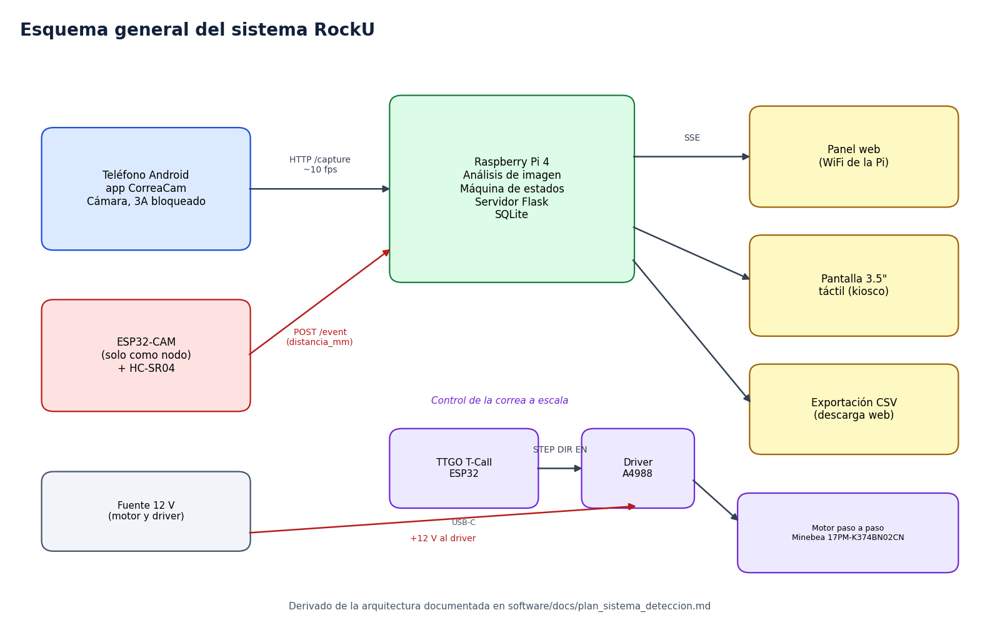

# Hardware

Esta carpeta documenta el hardware completo del prototipo, desde la justificación de cada componente hasta el montaje.

## Carpetas

- `esquemas/` tiene el esquema general del sistema y el detalle de la perfboard del control del motor.
- `bom/` contiene la lista de materiales con cantidades y costo total.
- `fotos/` reúne las fotos del prototipo armado.

> Las fotos de `fotos/` son **ilustraciones inventadas** para completar el ejemplo. El esquema general y la documentación de la perfboard sí vienen del proyecto real.

## Componentes principales y por qué se eligieron

| Componente | Función | Justificación técnica |
|---|---|---|
| Raspberry Pi 4 Model B | Analiza imagen, decide el estado y sirve el panel | El análisis trabaja sobre cuadros reducidos a 640x480 a unos 10 por segundo, carga que un procesador de 4 núcleos resuelve sin acelerador. Corre Linux, Python y SQLite sin cambios. Pide una fuente de 5 V y 3 A |
| Teléfono Android | Cámara cenital | La ESP32-CAM entregó 320x240 a 5.6 cuadros por segundo y tinte verdoso. El teléfono entrega 1080x1440 a 10.3 cuadros por segundo y permite bloquear exposición, balance de blancos y enfoque |
| HC-SR04 | Detecta objetos que pasan sobre la correa | Mide de 2 a 400 cm con un cono de unos 15 grados, suficiente para una correa de 15 cm de ancho con el sensor a 12 cm. Consume alrededor de 15 mA a 5 V |
| ESP32-CAM, solo como nodo | Lee el HC-SR04 y avisa a la Pi por WiFi | Ya estaba disponible y tiene WiFi. Su cámara no se usa |
| ESP32 TTGO T-Call V1.4 | Genera los pulsos STEP y DIR del motor | Lógica de 3.3 V, igual que la entrada del driver. Se evitaron los pines del módem SIM800L, por eso ENABLE va en el GPIO25 |
| Driver A4988 (HR4988) | Controla el motor paso a paso | Soporta VMOT de 8 a 35 V y micropasos hasta 1/16. Con Rs de 0.10 Ω, un Vref de 0.24 V da una corriente de 0.3 A |
| Motor Minebea 17PM-K374BN02CN | Mueve la correa a escala | Paso de 1.8 grados, 200 pasos por vuelta. Con 1/16 de micropaso gira suave a las velocidades de 5 a 15 cm/s |
| Condensador de 100 µF y 25 V | Protege el driver | Absorbe los picos de tensión que genera la carga inductiva del motor |
| Fuente de 12 V | Alimenta motor y driver | Queda lejos del máximo de VMOT |
| Pantalla de 3.5 pulgadas con touch | Muestra el estado en la caja | Se ve desde lejos, funciona en modo kiosco y no necesita más pines que el bus SPI |
| Lámparas LED de corriente continua | Iluminan la correa | Las luces de corriente alterna parpadean a 50 Hz y se notan con exposiciones cortas |

Los valores de consumo y rango son los típicos de las hojas de datos, listadas en [FUENTES.md](../FUENTES.md).

## Esquemático y BOM

- [Esquema general del sistema](esquemas/esquema_sistema.png)
- [Perfboard del control del motor, con coordenadas, recorridos de cable y revisión con multímetro](esquemas/detalle_perfboard.md)
- [BOM con cantidades y costo total](bom/BOM.csv)

## Instrucciones de ensamble

### Montaje mecánico

1. Fija el brazo del teléfono a 28 cm sobre la correa, centrado y mirando hacia abajo, con el avance de la correa a lo largo del lado largo de la imagen.
2. Fija el brazo del sensor a 12 cm sobre la correa, aguas arriba del campo de la cámara.
3. Instala las dos lámparas LED a unos 45 grados, a cada lado de la correa.
4. Atornilla la caja de control sobre la mesa, fuera del campo de la cámara.

### Montaje eléctrico

1. Arma la perfboard con el orden del documento [detalle_perfboard.md](esquemas/detalle_perfboard.md). Sigue la revisión con multímetro antes de poner el driver y la TTGO.
2. Conecta el motor al header J1 con los 12 V desconectados.
3. Conecta el HC-SR04 al ESP32-CAM con un divisor de voltaje en ECHO, de 1 kΩ y 2 kΩ. TRIG va a GPIO13 y ECHO a GPIO14.
4. Conecta la TTGO por USB-C y luego los 12 V en TB1.

### Precauciones

- Nunca conectes ni desconectes el motor con los 12 V conectados. Puede quemar el driver.
- Respeta la polaridad del condensador, la pata larga va a VMOT.
- El ECHO del HC-SR04 sale a 5 V y el ESP32 trabaja a 3.3 V, así que el divisor es obligatorio.
- No uses los GPIO 0, 2, 12, 15 ni 16 del ESP32-CAM, porque participan en el arranque y en la cámara.

## Especificaciones técnicas

| Dato | Valor |
|---|---|
| Alimentación de la Pi | 5 V y 3 A por USB-C |
| Alimentación del motor | 12 V |
| Corriente del motor | 0.3 A, ajustada con Vref de 0.24 V |
| Distancia cámara a correa | 28 cm |
| Distancia sensor a correa | 12 cm |
| Velocidad de la correa | 5 a 15 cm/s |

## Diseño para la reparación

> Esta sección describe el diseño previsto para la caja de ejemplo. El montaje de la perfboard con sockets es real, el resto de decisiones de la caja es inventado.

- El driver A4988 y la TTGO van en sockets, así que se cambian sin soldar. Son las piezas que con más probabilidad fallan.
- La entrada de 12 V usa bornera de tornillo y el motor un header, por lo que se desconectan sin herramientas especiales.
- La Raspberry Pi y la perfboard van sobre separadores M3 atornillados a la base. No hay pegamento ni fijaciones permanentes.
- La tapa se abre con 4 tornillos M3 y deja a la vista todos los componentes.
- Los puertos USB y Ethernet de la Pi quedan accesibles desde el costado de la caja, sin abrirla.
- Cada cable de la perfboard tiene un color fijo según su función, documentado en la tabla de conexiones.
