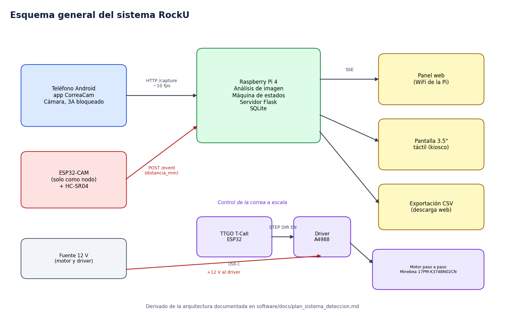

# Esquemas

## Contenido

| Archivo | Qué muestra |
|---|---|
| [esquema_sistema.png](esquema_sistema.png) | Diagrama general con teléfono, Pi, ESP32 con sensor, control del motor y salidas |
| [detalle_perfboard.md](detalle_perfboard.md) | Perfboard del control del motor con posiciones, conexiones, ajuste del driver, armado y revisión con multímetro |
| Imágenes `01` a `07` | Vistas 3D de la perfboard usadas por el documento anterior |

## Nota sobre el origen

El diagrama general lo dibujamos a partir de la arquitectura descrita en [software/docs/plan_sistema_deteccion.md](../../software/docs/plan_sistema_deteccion.md). El detalle de la perfboard y sus imágenes vienen del proyecto RockU. El modelo 3D de la perfboard está en [diseno_3d/fusion360](../../diseno_3d/fusion360).

En un proyecto real conviene sumar un esquemático hecho en Fritzing, Wokwi o KiCad con cada pin etiquetado. El detalle de la perfboard hace esa función para la parte del motor.
