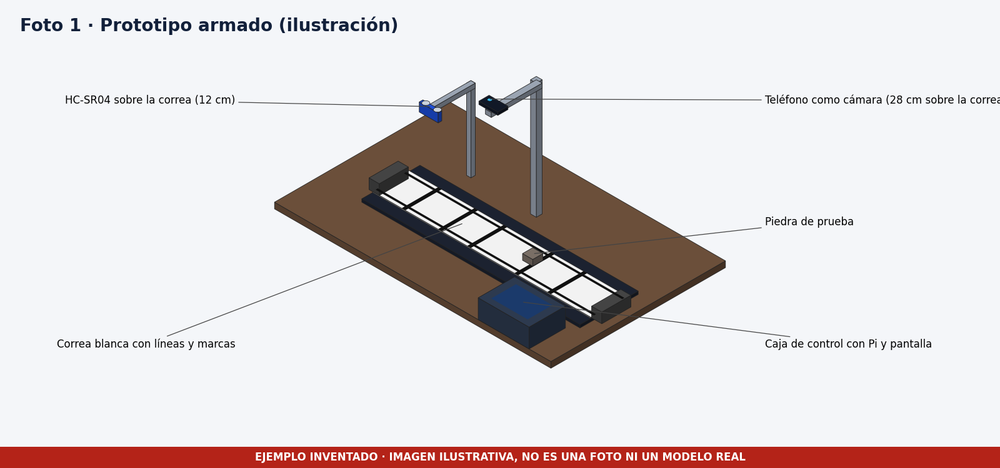
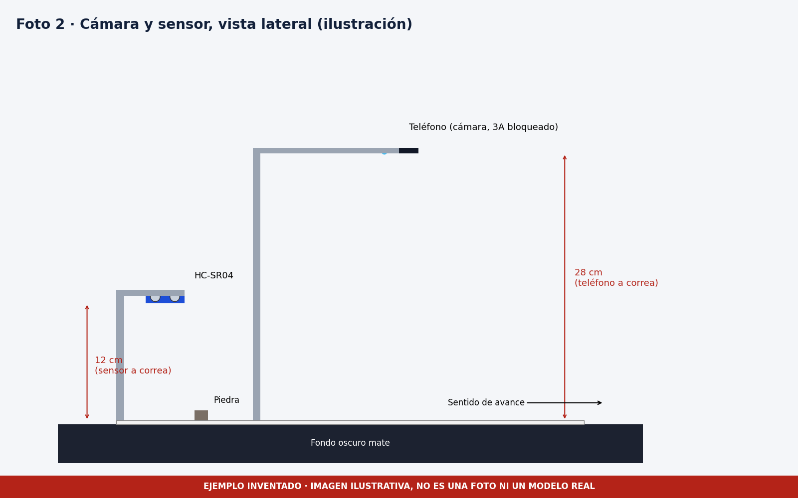
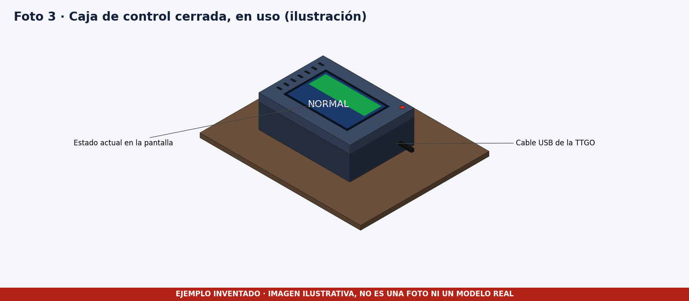
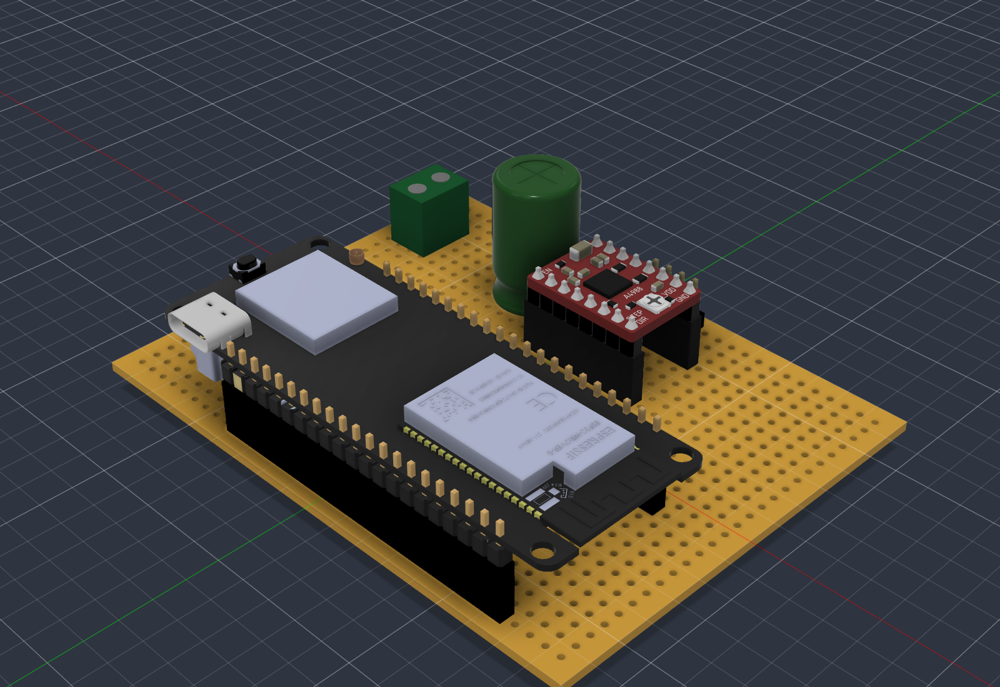
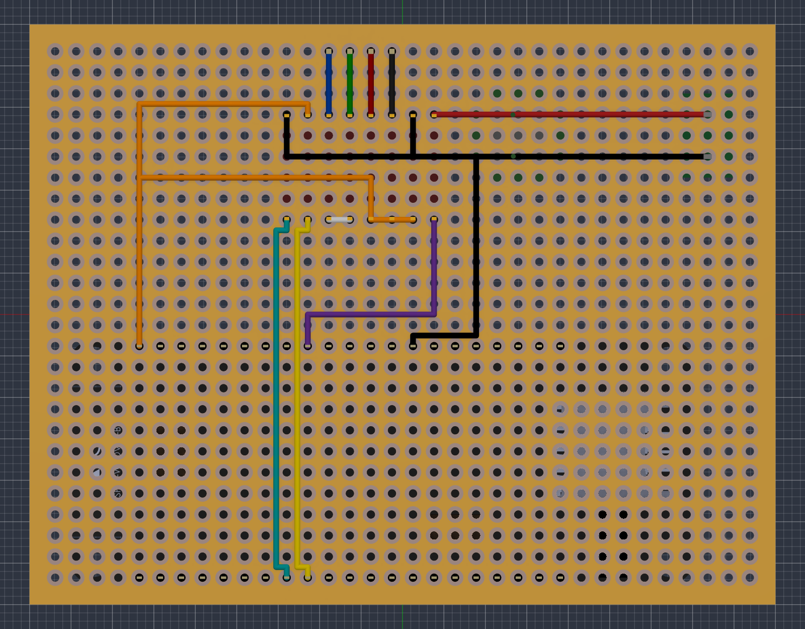

# Fotos del prototipo

> **Estas imágenes son ilustraciones inventadas.** Se dibujaron con código para que el ejemplo tenga una carpeta de fotos completa. Llevan una franja roja con esa advertencia. En tu proyecto debes subir fotos reales del prototipo, en alta resolución y desde varios ángulos, con los cables etiquetados.

| Imagen | Qué debería mostrar una foto real |
|---|---|
| [foto_01_prototipo_general.png](foto_01_prototipo_general.png) | Vista general con la correa, el brazo del teléfono, el sensor y la caja de control |
| [foto_02_camara_y_sensor.png](foto_02_camara_y_sensor.png) | Vista lateral con las distancias reales de la cámara y del sensor a la correa |
| [foto_03_caja_de_control.png](foto_03_caja_de_control.png) | Caja cerrada con la pantalla encendida mostrando el estado |

## Vistas 3D reales de la perfboard

Estas sí vienen del modelo del proyecto y están en [../esquemas](../esquemas).

