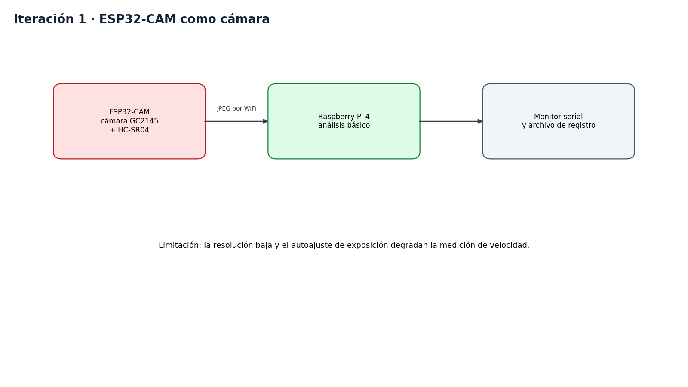

# Iteración 1, concepto inicial

Fecha de ejemplo, 20-03-2026. El detalle de fechas es inventado.

## Qué se hizo

Un ESP32-CAM con el sensor GC2145 enviaba imágenes por WiFi a la Raspberry Pi. La Pi las analizaba de forma básica y mostraba el resultado en el monitor serial.

## Qué se midió

Con 50 cuadros consecutivos por WiFi, el ESP32-CAM entregó 320x240 a 5.6 cuadros por segundo, con un peso medio de 5.6 KB frente a una pared lisa.

## Problemas encontrados

- El sensor GC2145 no soporta JPEG por hardware con el driver del ESP32. Entrega formato crudo y mensajes `FB-SIZE` intermitentes.
- La imagen tenía un tinte verdoso.
- La resolución era demasiado baja para medir velocidad con precisión.

## Decisión

Se descartó la cámara del ESP32-CAM y se probó un teléfono Android como cámara. El ESP32-CAM quedó como nodo del sensor de distancia.

## Archivos

Los scripts de esta etapa evolucionaron en [software/src/pi](../../software/src/pi). Las medidas están en [plan_sistema_deteccion.md](../../software/docs/plan_sistema_deteccion.md), sección 6.
