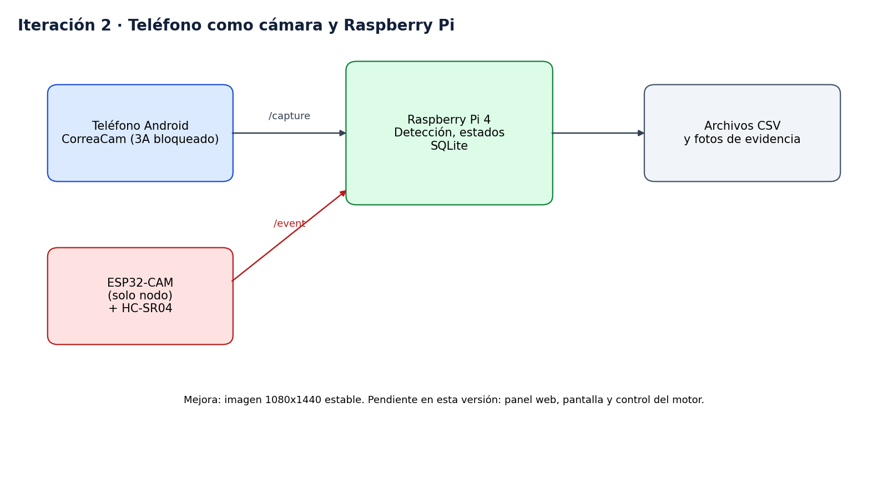

# Iteración 2, teléfono como cámara

Fecha de ejemplo, 02-10-2026. El detalle de fechas es inventado.

## Qué cambió

- Se creó la app CorreaCam en Kotlin con CameraX y NanoHTTPD. Sirve `/capture`, `/status` y `/config`, y bloquea exposición, balance de blancos y enfoque.
- Se escribieron los algoritmos de detección en `deteccion.py`, con velocidad por correlación de fase y alineación por las dos líneas de la correa.
- Se agregaron `grabar.py` y `analizar.py` para grabar cuadros etiquetados y calibrar.
- Se armó un simulador de correa para validar sin hardware.

## Qué se midió

| Fuente | Resolución | Velocidad | Tamaño medio |
|---|---|---|---|
| ESP32-CAM | 320x240 | 5.6 cuadros por segundo | 5.6 KB |
| Teléfono con CorreaCam | 1080x1440 | 10.3 cuadros por segundo | 120 KB |

Con imágenes sintéticas, el error de velocidad quedó bajo 1.2 % entre 60 y 150 mm/s.

## Problemas encontrados

- Con poca luz, la exposición automática eligió 30 ms y la imagen salía movida. La solución fue bloquear la exposición y agregar más luz.
- El operador no tenía cómo ver el estado, solo archivos CSV.

## Decisión

Construir el servidor con panel y pantalla, y sumar el control del motor para tener una correa que se mueva a velocidad conocida.

## Archivos

[software/src/pi/deteccion.py](../../software/src/pi/deteccion.py), [software/src/android](../../software/src/android) y [software/src/pi/simulador.py](../../software/src/pi/simulador.py).
