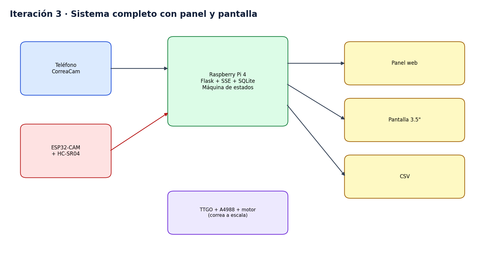
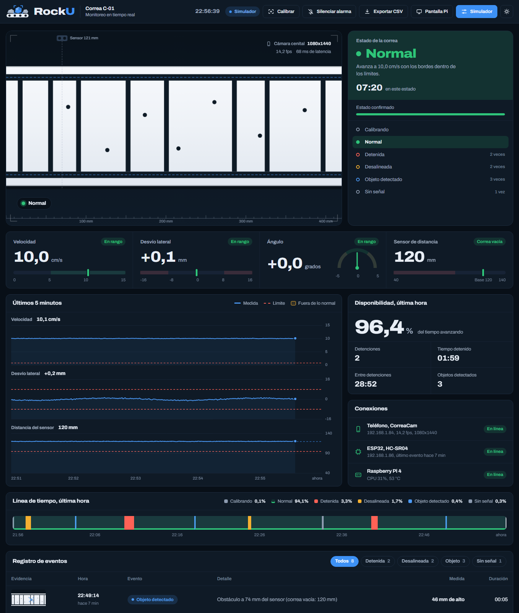

# Iteración 3, sistema completo

Fecha de ejemplo, 29-05-2026. El detalle de fechas es inventado.

## Qué cambió

- El servidor Flask expone la API, un stream en vivo y las exportaciones CSV.
- El panel web y la pantalla de 3.5 pulgadas muestran estado, medidas, gráficos, disponibilidad y eventos.
- SQLite guarda muestras y eventos, y la Pi sirve el histórico.
- La perfboard con la TTGO y el driver A4988 mueve la correa a escala.
- Se agregó la caja de control con tapa, ventilas y puertos accesibles.
- Se midió el desempeño con condiciones moderadas y extremas, ver [testing](../../testing/README.md).

## Resultados

El resumen de la simulación y las pruebas está en el [reporte de testing](../../testing/reportes/reporte_testing.md).

## Pendiente

- Validar los umbrales con la correa real.
- Programar el firmware del ESP32 que lee el HC-SR04 y envía los eventos.
- Configurar la Pi como punto de acceso WiFi con IPs fijas para la demo.

## Archivos

[software/src](../../software/src), [hardware](../../hardware) y [diseno_3d](../../diseno_3d).
