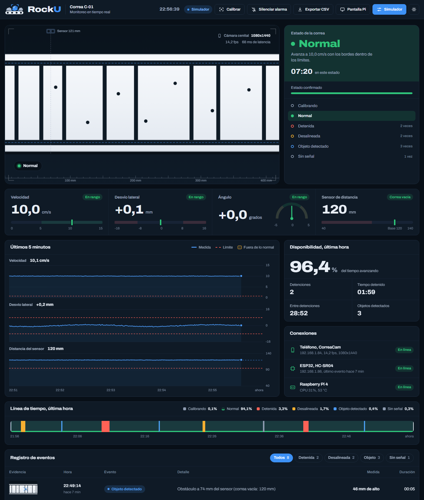
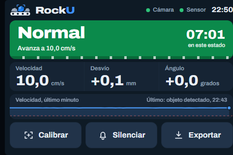

# Captura de datos, repositorio e información generada

Este documento responde a tres criterios de la rúbrica, cómo se capturan los datos, dónde se guardan y cómo se convierten en información útil para el problema.

## Captura de datos

El sistema tiene dos fuentes de datos que trabajan en paralelo.

| Fuente | Qué mide | Frecuencia | Por qué esa frecuencia |
|---|---|---|---|
| Teléfono con CorreaCam | Imagen de la correa a 1080x1440 | Unos 10 cuadros por segundo | La correa se mueve entre 5 y 15 cm/s, así que entre cuadros avanza 0.5 a 1.5 cm. Es poco para la correlación de fase y alcanza para confirmar un cambio de estado en menos de un segundo |
| ESP32 con HC-SR04 | Distancia a la correa | Unas 20 lecturas por segundo | Un objeto de unos pocos centímetros pasa bajo el sensor en pocas décimas de segundo, por lo que una lectura lenta lo perdería |

De los cuadros el sistema extrae velocidad, desvío lateral y ángulo. Del sensor extrae la distancia. Esas cuatro medidas forman una muestra por segundo.

La app bloquea exposición, balance de blancos y enfoque para que la medición no se degrade con el autoajuste de la cámara. En la medición propia, la ESP32-CAM entregó 5.6 cuadros por segundo a 320x240 y el teléfono 10.3 a 1080x1440, razón por la que se cambió la cámara.

Si el teléfono deja de enviar cuadros durante 2 segundos, el sistema pasa al estado `SIN_SENAL` en lugar de inventar datos.

## Repositorio de datos

La Pi guarda todo en un archivo SQLite (`rockU.db`) con dos tablas.

| Tabla | Contenido |
|---|---|
| `muestras` | Una fila por segundo con tiempo, velocidad, desvío lateral, ángulo, distancia y estado |
| `eventos` | Una fila por evento con tiempo, tipo, duración, detalle, valor medido, foto asociada y una copia de las medidas del momento |

Las muestras se conservan 30 días por defecto (`--dias-muestras`) y los eventos quedan sin límite. Hay un índice por tiempo en cada tabla, así que consultar un rango de fechas es rápido incluso con semanas de datos.

El histórico se descarga desde `/export/muestras.csv` y `/export/eventos.csv`, o con el botón Exportar CSV del panel. Hay filtros `desde` y `hasta` y un separador configurable. Los archivos usan UTF-8 con BOM para abrirse bien en Excel en español. La copia automática a un pendrive sigue en el plan del sistema y no está implementada.

Las fotos de cada evento se guardan en `fotos/` y el evento guarda la ruta.

## Dashboard y visualización

El panel web muestra en una sola pantalla lo que un operador necesita para decidir.

- La vista cenital de la correa, con el estado confirmado y la medida del sensor.
- Cuatro tarjetas con velocidad, desvío lateral, ángulo y distancia, cada una con su rango normal.
- Gráficos de los últimos 5 minutos con la línea de límite y marcas cuando la medida sale de lo normal.
- Una línea de tiempo de la última hora con el porcentaje de tiempo en cada estado.
- El registro de eventos con foto, hora, detalle y duración, filtrable por tipo.

La pantalla de 3.5 pulgadas de la Pi muestra solo el estado en grande y tres botones, para que se lea desde lejos.

Estas capturas salen del modo simulador, que usa la misma máquina de estados que el modo real.

## Generación de información

El sistema no entrega números sueltos. Los convierte en indicadores que responden a la pregunta del problema, si la correa está produciendo o no y por qué.

| Indicador | Cómo se calcula | Para qué sirve |
|---|---|---|
| Estado confirmado | Una condición debe mantenerse varios cuadros seguidos antes de cambiar el estado | Evita falsas alarmas por un cuadro malo |
| Disponibilidad de la última hora | Porcentaje de tiempo con la correa avanzando | Resume cuánta producción se perdió |
| Número de detenciones y tiempo detenido | Conteo y suma de duraciones de los eventos `DETENIDA` | Permite comparar turnos |
| Tiempo entre detenciones | Promedio entre inicios de detención consecutivos | Muestra si las fallas se vuelven más frecuentes |
| Alerta de desalineación | Desvío mayor a 3 mm o ángulo mayor a 1 grado con los umbrales calibrados | Avisa antes de que la correa roce la estructura |
| Alerta de objeto | La distancia cae bajo la base menos un margen durante 2 o 3 lecturas | Dispara una foto como evidencia |
| Umbrales calibrados | Se calculan del ruido medido con la correa en condición normal | Los umbrales se adaptan a cada instalación |

Los límites visibles en el panel (detenida bajo 0.8 cm/s, desvío mayor a 8 mm, ángulo mayor a 2 grados) son los del modo simulador. En el modo real salen del archivo `calibracion.json`.

## Archivos relacionados

- [registro.py](../src/pi/registro.py) define las tablas y la exportación.
- [deteccion.py](../src/pi/deteccion.py) calcula las medidas y el estado.
- [api.md](api.md) describe cada endpoint.
