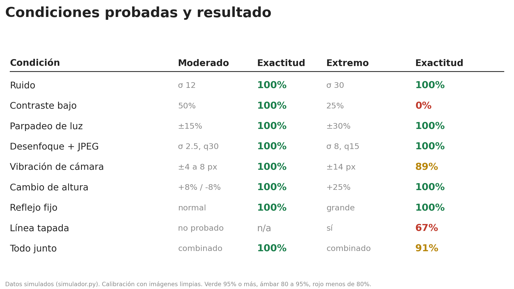
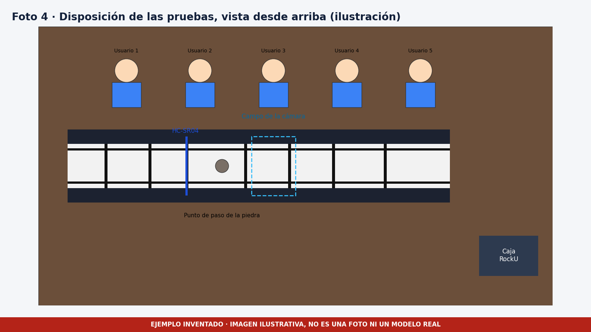

# Evidencias

Los gráficos `01` a `13` son reales y salen de `software/src/pi/graficos_ppt.py` con las métricas de la simulación. El archivo `setup_prueba_ilustracion.png` es una **ilustración inventada** de la disposición de las pruebas con la correa física.

| Archivo | Qué muestra |
|---|---|
| 01_resumen_exactitud.png | Exactitud por nivel de dificultad |
| 02_f1_por_clase_niveles.png | F1 de cada clase por nivel |
| 03_precision_recall_extremo.png | Precisión y recall en condiciones extremas |
| 04_matriz_confusion_extremo.png | Matriz de confusión en condiciones extremas |
| 05_exactitud_por_grupo.png | Exactitud por grupo de escenarios |
| 06_modos_de_falla.png | Dónde y cómo se equivoca el clasificador |
| 07_sensibilidad_lateral.png | Respuesta ante distintos desvíos laterales |
| 08_sensibilidad_angulo.png | Respuesta ante distintos ángulos |
| 09_sensibilidad_velocidad.png | Respuesta ante distintas velocidades |
| 10_errores_medicion.png | Error de velocidad, desvío y ángulo |
| 11_latencia_confirmacion.png | Tiempo en confirmar cada cambio de estado |
| 12_peores_escenarios.png | Los escenarios con menor exactitud |
| 13_tabla_condiciones.png | Condiciones probadas y resultado |

Las capturas del panel están en [software/docs/img](../../software/docs/img).
