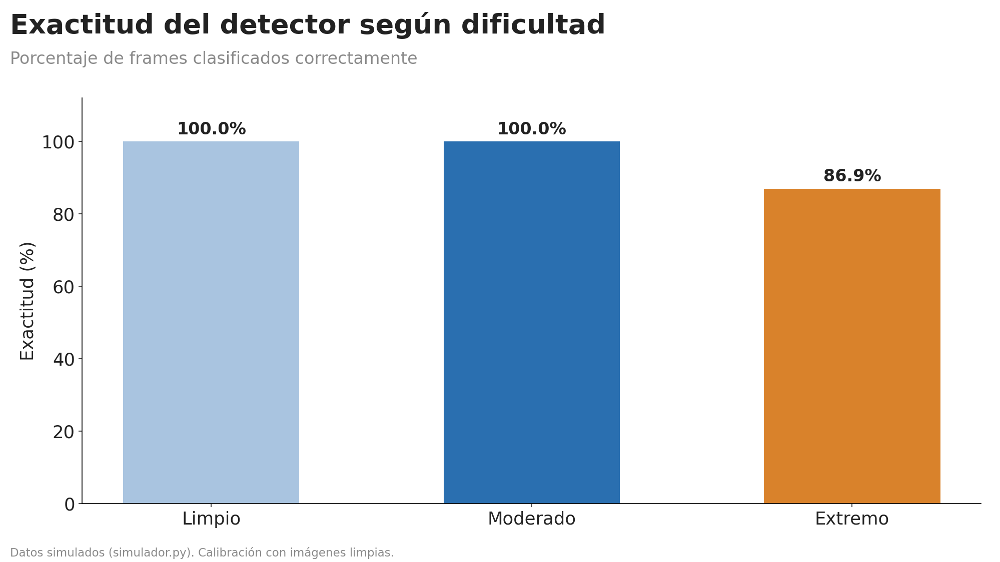
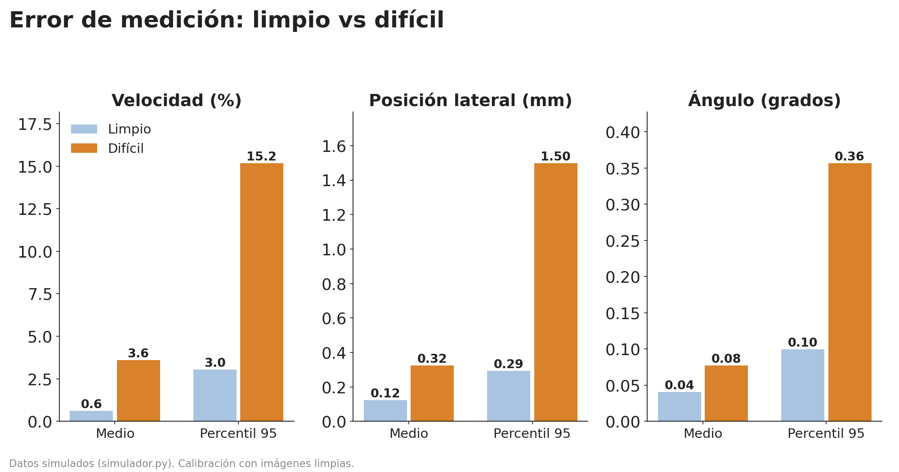
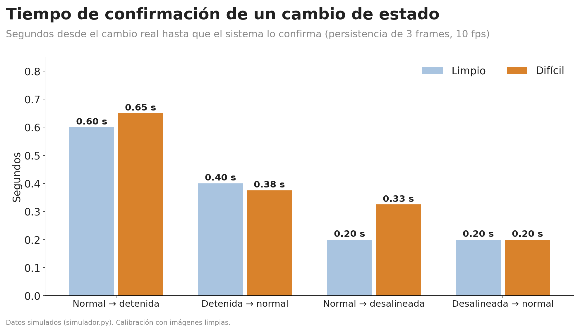
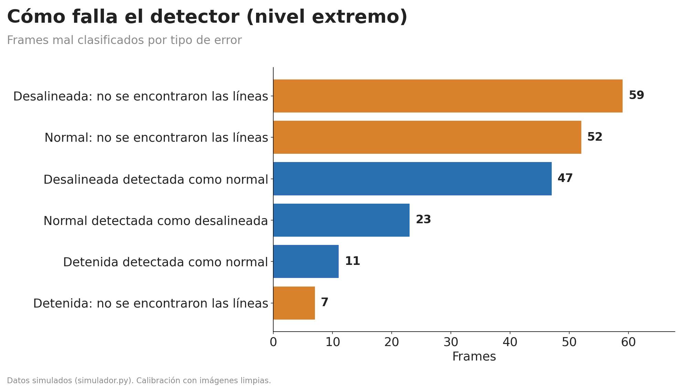
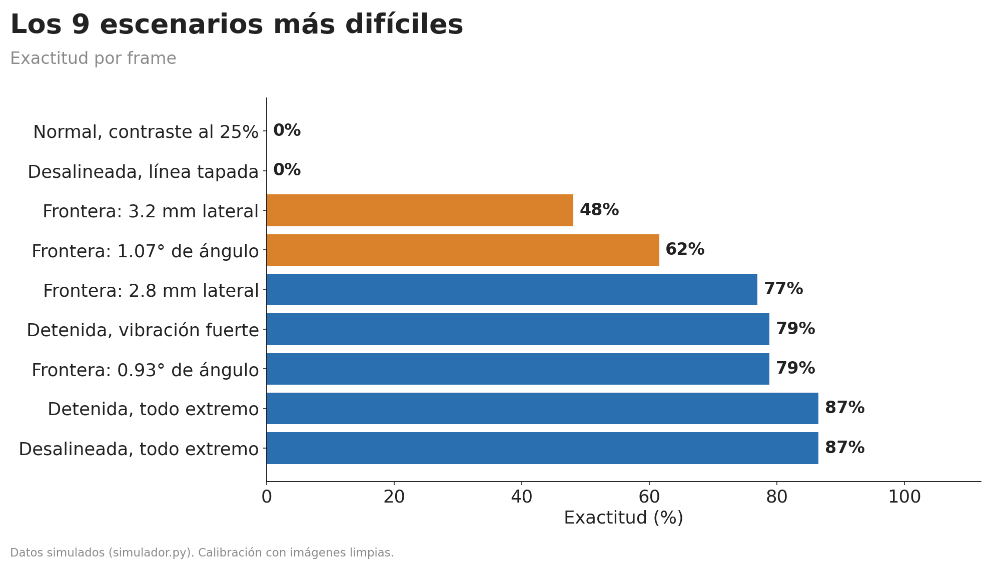
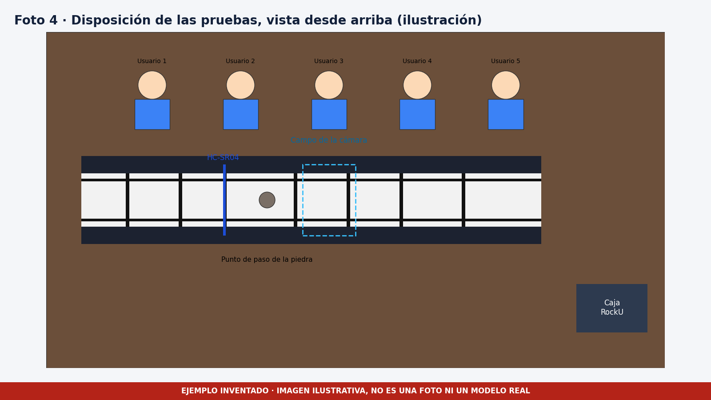

# Reporte de testing

Este reporte reúne los resultados de las tres pruebas del [protocolo](protocolo_pruebas.md).

> **Qué es real y qué es inventado.** Los resultados de la prueba A son reales y salen de los JSON de [testing/datos](../datos). Los de las pruebas B y C **son inventados** para ilustrar cómo presentar el análisis. No deben citarse como mediciones del proyecto.

## Prueba A, simulación (real)

### Exactitud del clasificador

| Conjunto | Cuadros | Exactitud | F1 macro |
|---|---|---|---|
| Caso base filtrado | 1 260 | 100 % | 1.000 |
| Caso base estricto | 1 396 | 98.0 % | 0.975 |
| Condiciones moderadas | 1 936 | 100 % | 1.000 |
| Condiciones extremas | 1 520 | 86.9 % | 0.893 |
| Todo junto | 3 456 | 94.2 % | 0.960 |

### Error de las medidas

| Medida | Caso base | Condiciones difíciles |
|---|---|---|
| Velocidad, error medio absoluto | 0.62 % | 3.59 % |
| Velocidad, percentil 95 | 3.04 % | 15.17 % |
| Desvío lateral, error medio absoluto | 0.12 mm | 0.32 mm |
| Ángulo, error medio absoluto | 0.04 grados | 0.08 grados |

### Tiempo de confirmación

| Cambio de estado | Tiempo medio, caso base | Tiempo medio, difícil |
|---|---|---|
| De normal a detenida | 0.60 s | 0.65 s |
| De detenida a normal | 0.40 s | 0.38 s |
| De normal a desalineada | 0.20 s | 0.33 s |
| De desalineada a normal | 0.20 s | 0.20 s |

### Dónde falla

Las fallas se concentran en tres casos, todos en el nivel extremo.

- Con contraste de 25 %, el detector no encuentra las líneas de la correa y clasifica todo como "otro". La exactitud cae a 0 % en ese escenario.
- Con la línea tapada, la desalineación no se puede medir y también cae a 0 %.
- Con valores muy cercanos al umbral, por ejemplo un desvío de 3.2 mm contra un umbral de 3 mm, el sistema oscila entre normal y desalineada. Ahí la exactitud baja a 48 %.

La vibración fuerte de la cámara también confunde detenida con normal en 11 de 52 cuadros.

Mejoras que salen de este análisis.

1. Fijar la cámara con un soporte rígido para atacar la vibración.
2. Mantener el contraste de la correa con iluminación fija y fondo oscuro mate.
3. Agregar un estado "sin líneas" que avise al operador en lugar de dar una clasificación incierta.
4. Sumar histéresis alrededor de los umbrales para que el estado no oscile.

## Prueba B, correa física (inventado)

Esta prueba supone terminado el firmware del sensor, que en el proyecto real sigue pendiente.

| Prueba | Repeticiones | Detectadas | Tasa | Latencia media | Criterio del protocolo | Resultado |
|---|---|---|---|---|---|---|
| Detención de la correa | 20 | 19 | 95 % | 0.8 s | 90 % o más | Cumple |
| Desalineación lateral de 6 mm | 20 | 18 | 90 % | 0.5 s | 90 % o más | Cumple |
| Paso de una piedra | 30 | 28 | 93 % | no aplica | 90 % o más | Cumple |
| Operación normal durante 30 minutos | | 1 falsa alarma | | | Menos de una | No cumple |

Los datos completos están en [pruebas_correa_fisica_inventadas.csv](../datos/pruebas_correa_fisica_inventadas.csv).

### Análisis de las fallas

- La detención que no se confirmó ocurrió con la luz baja de la mañana. La exposición bloqueada quedó corta y las marcas se veían con poco contraste. Es la misma falla que muestra la simulación con contraste bajo.
- Las dos desalineaciones no detectadas tenían una de las líneas tapada por un reflejo. Encaja con el modo de falla de línea tapada de la prueba A.
- Dos piedras bajas pasaron fuera del cono de 15 grados del sensor, que a 12 cm cubre unos 3 cm. Cubrir todo el ancho exigiría un segundo sensor.
- La falsa alarma vino de una vibración del brazo del sensor al encender la correa, y por eso no se cumplió el criterio de menos de una. Un soporte más rígido y la histéresis en los umbrales apuntan a este problema.

## Prueba C, usuarios (inventado)

| Usuario | Perfil | Tiempo para identificar el estado | Estados bien identificados |
|---|---|---|---|
| 1 | Estudiante de otra carrera | 4 s | 4 de 4 |
| 2 | Técnico de mantención | 6 s | 4 de 4 |
| 3 | Estudiante de ingeniería | 5 s | 4 de 4 |
| 4 | Profesor | 9 s | 3 de 4 |
| 5 | Supervisor de planta | 5 s | 4 de 4 |
| Promedio | | 5.8 s | 19 de 20, o 95 % |

Criterios del protocolo, 80 % o más de estados bien identificados y menos de 10 segundos. Ambos se cumplen.

Hallazgos de la entrevista.

- El color del estado se entiende rápido. El único error fue confundir "desalineada" con "objeto detectado".
- El técnico de mantención pidió ver la hora exacta de cada detención y el supervisor una alarma sonora además de la pantalla.
- Cuatro de cinco personas leyeron el estado en la pantalla antes de mirar los gráficos.

Mejoras que salen de la prueba.

1. Agregar un ícono distinto para cada estado, para no depender solo del color.
2. Habilitar el buzzer opcional que ya contempla el plan del sistema.

## Validación contra el problema

El problema era que las detenciones y las salidas de eje de la correa no se detectan a tiempo. Los resultados responden a eso de la siguiente manera.

- La simulación muestra que el sistema confirma una detención en unos 0.65 segundos y una desalineación en unos 0.3 segundos, lo que permite avisar al operador en cuanto ocurre.
- El panel convierte las medidas en disponibilidad, conteo de detenciones, tiempo detenido y tiempo entre detenciones, que son los datos que un supervisor usaría para decidir. Están explicados en [captura_y_datos.md](../../software/docs/captura_y_datos.md).
- Los resultados con la correa física y con usuarios son inventados, así que esta validación queda pendiente de medirse en un proyecto real.
